  

# 🛡️ Awesome Audit Logging & Administrative Compliance 📋

  
  
  
  
  

A curated directory and comparative benchmark of leading platforms, frameworks, SIEM systems, and open-source tools for **audit trails**, **administrative compliance**, **log analytics**, and **continuous security monitoring**. Designed for DevOps engineers, Site Reliability Engineers (SREs), SecOps teams, compliance officers, and system architects ensuring auditability for SOC 2, ISO 27001, HIPAA, PCI-DSS, GDPR, and FedRAMP.

---

## 📑 Table of Contents
- [🌐 Sector Overview & Market Dynamics](#-sector-overview--market-dynamics)
- [☁️ SaaS Platforms & Compliance Tools](#️-saas-platforms--compliance-tools)
- [🔓 Open-Source Audit Logging & SIEM Alternatives](#-open-source-audit-logging--siem-alternatives)
- [📐 Architectural & Pricing Model Distinctions](#-architectural--pricing-model-distinctions)
- [⭐ Star History](#-star-history)
- [🤝 Support & Contributing](#-support--contributing)

---

## 🌐 Sector Overview & Market Dynamics

The global market for Audit Logging, Log Management, and Security Information & Event Management (SIEM) is estimated at **$12B–$15B+ combined (with SIEM alone reaching ~$8.4B in 2026 and Log Management scaling past $4.3B)**, expanding at a ~10–15% CAGR driven by continuous auditing mandates (SOC 2, ISO 27001, HIPAA, DORA, and FedRAMP). 

The sector is **moderately fragmented**: massive public conglomerates and hyper-scalers (Cisco/Splunk, Datadog, Elastic) command substantial market share in large-scale SIEM and observability, yet intense market demand for specialized audit compliance, security lakehouses (e.g., Panther, Snowflake), and open-source ingestion runtimes prevents a single winner-take-all outcome.

---

## ☁️ SaaS Platforms & Compliance Tools

The table below benchmarks commercial SaaS solutions delivering audit trails, administrative security logging, SIEM, and automated governance. Tools are sorted in **descending order by company scale** (market capitalization / acquisition valuation).

| 🏢 Platform | 🏷️ Category | 📈 Company Scale (Valuation / Revenue) | 💵 Pricing (Specific Starting Tiers) | 🎁 Free Tier / Free Trial Limits | 🔍 Key Capabilities & Audit Trail Details |
|---|---|---|---|---|---|
| **Datadog Cloud SIEM** | Cloud SIEM & Observability | **~$48B+ Market Cap** ($3.43B FY2025 revenue) | **$5.00 per 1M analyzed events/month** (annual commitment; ~$0.10/GB ingest + $1.70/1M events indexed for 15-day retention) | **14-day free trial** with full platform access (fair-use ingestion caps; no credit card required) | 15-month analysis & retention; out-of-the-box detection rules, user activity tracking, administrative audit trails. |
| **Splunk Cloud Platform (ES)** | Enterprise SIEM & Forensics | **$28B Valuation** (Acquired by Cisco; ~$3.8B–$4B ARR) | **$9,498.99/year for 1 GB/day ingest** (Splunk Cloud Enterprise Security via CDW / annual license) | **15-day free trial** for Splunk Cloud Platform capped at **5 GB/day** (perpetual 500 MB/day free tier applies only to self-hosted Splunk Enterprise) | Comprehensive enterprise audit trail analysis, administrative forensics, compliance frameworks (PCI-DSS, HIPAA, SOC 2). |
| **Elastic Cloud Security (Serverless)** | Search-Powered SIEM & Analytics | **~$8B–$10B Market Cap** ($1.27B FY2025 revenue) | **$0.09/GB ingest + $0.017/GB retained/month** (Security Analytics Essentials tier; $0.11/GB ingest + $0.019/GB retained for Complete tier) | **14-day free trial** with full access to create serverless security projects (includes up to 50 GB data egress) | Serverless log ingestion, zero per-endpoint fees, prebuilt audit & compliance rules, tamper-resistant log indexing. |
| **Papertrail** (SolarWinds) | Cloud Log Management | **$3B–$4B Parent Market Cap** (SolarWinds; ~$750M revenue) | **$7.00/month** (includes 1 GB/month search data transfer + 1-year archive storage) | **Free forever plan: 50 MB/month data transfer**, search live logs up to 7 days, 7 days log archive retention | Instant log aggregation, live tailing of administrative activities, search alerts, syslog/API integration. |
| **AuditBoard** | GRC & Compliance Automation | **$3B+ Valuation** (Acquired by HgCapital; ~$200M+ ARR) | **~$30,000 to $45,947/year entry baseline** (Median spend ~$45,947/year; user seats ~$600–$1,500/seat/year plus 10–25% implementation fee) | **No free tier or public free trial**; access requires scheduled sales demonstration and negotiated enterprise PoC | End-to-end administrative audit controls, SOX/SOC 2 compliance automation, evidence management, issue remediation. |
| **Sumo Logic Cloud SIEM** | Cloud SIEM & Log Analytics | **$1.7B Valuation** (Acquired by Francisco Partners; ~$300M ARR) | **$0.225 per credit** (Enterprise Security plan; Flex pricing benchmarks at 40 credits/GB for Cloud SIEM ingest and $1.50/credit) | **30-day free trial** capped at **1 GB/day** (up to 20 users, 30 days retention); reverts to **perpetual Free plan with limited daily credits**, 7-day retention, and 3 users | Automated threat detection, Cloud SIEM rules engine, audit event mapping, multi-cloud log normalization. |
| **Panther** | Cloud-Native SIEM & Security Lakehouse | **$1.4B Valuation** (Series B unicorn; acquired by Databricks; ~$50M ARR) | **$50,000/year base tier** (Includes ~1 TB/month log intake; Vendr benchmark median spend $50K–$75K+) | **Custom sales-assisted free trial / PoC** (typically 14 to 30 days upon sales consultation; no self-service free tier) | Detection-as-code (Python), Snowflake/data lake security telemetry, real-time administrative access auditing. |
| **Druva Audit Trail** *(Data Resiliency Cloud)* | Cloud Data Protection & Compliance | **$2B Peak Valuation** ($619M secondary; $200M+ ARR) | **$8.00 per user/month starting** (Platform pricing for Druva Data Resiliency Cloud; feature included with core backup platform) | **30-day free trial** with full access to workload backup and admin audit logging (extendable up to 60 days via MSC) | Immutable administrative activity logs, downloadable CSV/HTML compliance reports, configurable 30-day to 3-month retention. |

---

## 🔓 Open-Source Audit Logging & SIEM Alternatives

Open-source systems provide transparent, auditable control over telemetry pipelines without vendor lock-in. The table below is sorted in **descending order by GitHub Stars_Count**, with live social Stars_Badges linking directly to each repository's stargazers.

| 📦 Repository & GitHub_Stars | 🏷️ Focus Area | 💡 Description | ⚙️ Deployment & Infrastructure Considerations |
|---|---|---|---|
| **[osquery](https://github.com/osquery/osquery)**    | Endpoint Auditing & SQL Instrumentation | Exposes an entire operating system as a high-performance relational database, enabling SQL queries for user logins, process auditing, file integrity monitoring (FIM), and security forensics. | Self-hosted C++ daemon running across Linux, macOS, and Windows. Highly performant; zero licensing fees. |
| **[Wazuh](https://github.com/wazuh/wazuh)**    | Open-Source XDR & SIEM | Full-featured open-source security monitoring solution providing log analysis, file integrity monitoring, vulnerability detection, and regulatory compliance mapping (PCI DSS, GDPR, HIPAA, NIST). | Self-hosted distributed cluster (manager, indexer, dashboard) or managed cloud. Integrates directly with OpenSearch. |
| **[Logstash](https://github.com/elastic/logstash)**    | Telemetry & Ingestion Pipeline | Server-side data processing pipeline that ingests audit logs from myriad sources simultaneously, transforms them, and ships them to a storage repository like Elasticsearch. | JVM-based ingestion pipeline. Requires appropriate memory tuning for high-throughput enterprise event streams. |
| **[Fluentd](https://github.com/fluent/fluentd)**    | Unified Logging Layer | CNCF graduated unified logging engine that decouples data sources from backend storage systems, creating reliable, structured JSON audit log streams. | Pluggable Ruby/C architecture with 500+ ecosystem plugins. Ideal for Kubernetes log routing and auditing. |
| **[Falco](https://github.com/falcosecurity/falco)**    | Cloud-Native Runtime Security & Kernel Auditing | De-facto Kubernetes threat detection and kernel activity audit engine leveraging eBPF to detect unexpected administrative behavior, shell execution, and privilege escalation in real time. | Lightweight kernel/eBPF probe; minimal CPU overhead; triggers alerts into syslog, webhooks, or SIEM collectors. |
| **[Fluent Bit](https://github.com/fluent/fluent-bit)**    | Fast & Lightweight Telemetry Forwarder | Super-fast, lightweight log processor and forwarder written in C, built for collecting audit events from edge devices, containers, and embedded systems. | Extremely low memory footprint (~450KB runtime memory); native integration with cloud backends and OpenTelemetry. |
| **[Graylog Server](https://github.com/Graylog2/graylog2-server)**    | Centralized Log Management & SIEM | Centralized log collection, indexing, and visualization engine with built-in audit trails, alerting pipelines, and compliance dashboards. | Community edition is free (SSPL/GPL). High-volume (1 TB/day) deployments require dedicated Elasticsearch/OpenSearch and MongoDB storage clusters. |
| **[OpenTelemetry Collector](https://github.com/open-telemetry/opentelemetry-collector)**    | Vendor-Neutral Telemetry Aggregator | Vendor-agnostic proxy that receives, processes, and exports telemetry (logs, metrics, and traces), allowing compliant routing of audit events to multiple backends. | Go-based concurrent daemon. Standardizes log collection across multi-cloud environments. |
| **[Tracee](https://github.com/aquasecurity/tracee)**    | eBPF System Activity & Forensic Tracing | Uses Linux eBPF technology to trace system calls, monitor kernel-level administrative events, and produce immutable forensic security trails. | Zero kernel modifications required; rich event filtering reduces noise before streaming to SIEM pipelines. |

---

## 📐 Architectural & Pricing Model Distinctions

Understanding how SaaS vendors calculate billing is essential for avoiding surprise log overage costs:

1. **📊 Daily Raw Ingest Metric (Splunk, Elastic):** Charges scale with raw gigabytes ingested daily. Effective when precise edge filtering drops non-critical telemetry before ingest.
2. **🎯 Analyzed Event Count Metric (Datadog):** Ingestion is separated from threat analytics; users pay per 1 million events scrutinized by rule engines.
3. **⚡ Credit Multipliers by Workload (Sumo Logic):** Core SIEM workloads consume higher credit multiples (e.g., 40 credits/GB for SIEM analytics vs. 25 credits/GB for basic logs).
4. **🏢 Platform-Wide Annual Subscriptions (AuditBoard, Panther):** Predictable enterprise annual contracts starting at $30K–$50K+ annually, decoupling cost from sudden log volume spikes.
5. **⏱️ Transfer Volume & Retention Duration (Papertrail):** Predictable monthly tiers scaling with search transfer allocations and archival timeframes.

---

## 🌟 Star History

---

## 🤝 Support & Contributing

Thank you for exploring and supporting **Awesome Audit Logging & Administrative Compliance**! 🌟

Maintaining a thoroughly benchmarked and verified repository takes extensive continuous research. If this resource has helped your team design compliance infrastructure, select a SIEM platform, or pass an audit, please consider supporting the project:

- ⭐ **Star this repository** to help others discover it across GitHub.
- 🍴 **Fork the project** and submit pull requests to add new tools or benchmark updates.
- 📢 **Share with your colleagues** on LinkedIn, X/Twitter, or Reddit.
- ☕ **Buy a coffee & sponsor the author:** Support ongoing open-source work via the [GitHub Sponsors Dashboard](https://github.com/sponsors/ishandutta2007).
